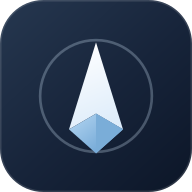
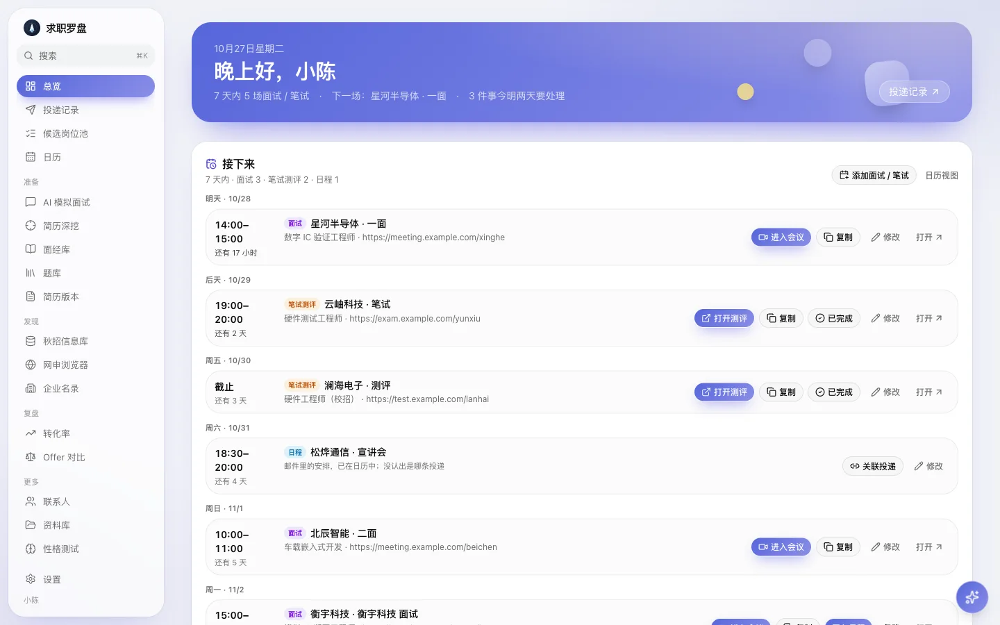
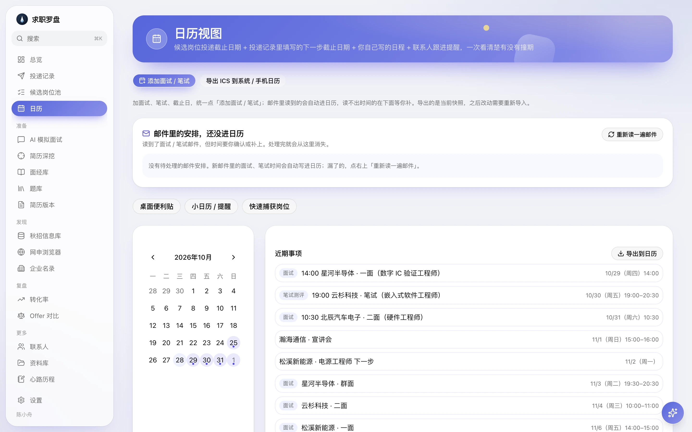
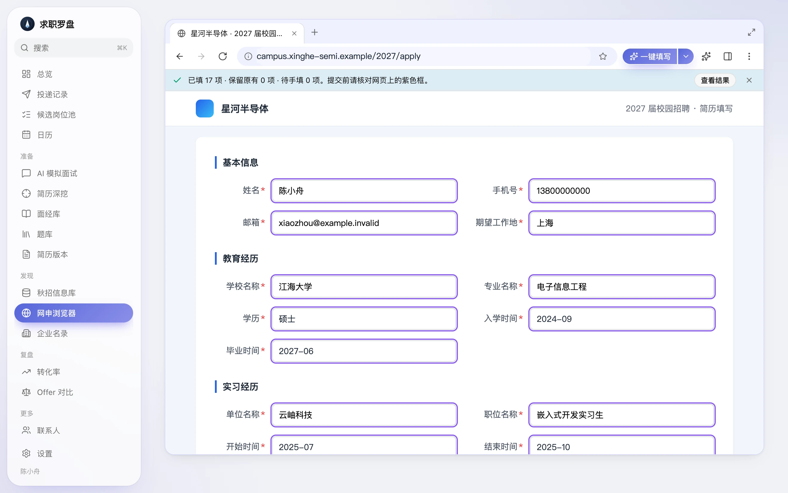
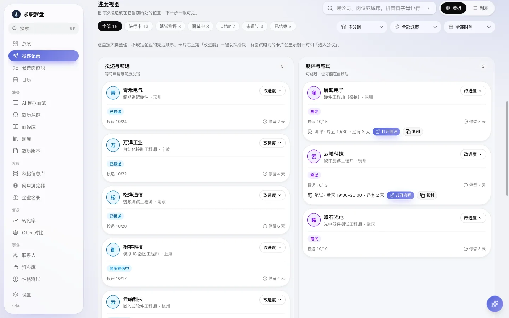
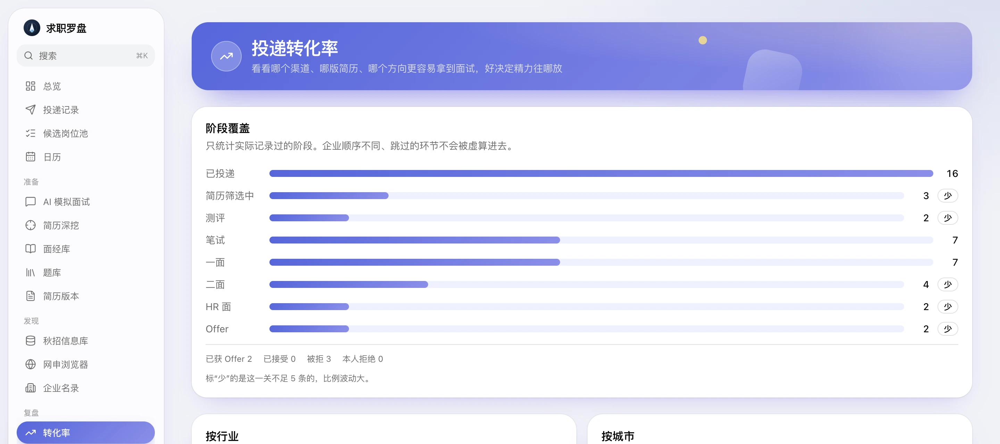

<div align="center">



# 求职罗盘

**给秋招的桌面软件：读邮件排日历，网申一键填，每次进展记在一处。**

数据只存在你自己的电脑上 · 免费 · 不用注册账号 · Mac / Windows

[**下载最新版**](https://github.com/yihongchen772-alt/careerplatform-local/releases/latest) ·
[介绍网页](https://yihongchen772-alt.github.io/careerplatform-local/) ·
[更新记录](https://github.com/yihongchen772-alt/careerplatform-local/releases)



</div>

## 秋招投到后面，最怕这三件事

- 投了几十家，**哪家到哪一步**，自己都说不清
- 面试邀请埋在邮箱里，**看漏一封**，机会就没了
- 每家网申表单**一模一样地重填**，填到手酸

求职罗盘把这三件事交给软件盯着。

## 它能做什么

### 读邮件，自动排日历

绑上你的邮箱，软件读招聘邮件，把面试、笔试、测评的时间排进日历，并更新那条投递的进度。

- HTML 排版的邮件也能读，笔试时间、测评截止、会议链接都认得出
- 读不出具体时间的，放在「还没进日历」里等你补一下
- 每一次自动更新都能撤销，不会悄悄改掉你自己填的



### 网申浏览器：表单填一次就够

软件里自带一个像 Chrome 一样的浏览器。打开企业的网申页，点「一键填写」，基本信息、教育经历、实习、项目、奖项按你的资料填好，填过的框用紫色标出来，核对完就能提交。

- 分好几页的申请，翻到下一页自动接着填；资料里的经历比页面栏目多，会自动点页面上的「添加」补齐（**不会点提交**）
- 下拉框会先看清有哪些选项再选；「只能填一个城市」「最多 3 个」这类提示也会照着填
- 简历里没有的信息**不乱填**，标成「待手填」交给你
- 开放题可以让小欧（AI 助手）起草，你看过再点「填进这一栏」
- 你手填过的内容会记进网申资料（可撤销），下次不用再填
- 覆盖飞书、Moka、北森等常见校招系统；另有 [Chrome / Edge 插件](DEVELOPMENT.md#浏览器插件chrome--edge)，在你平时用的浏览器里同样能填



### 投递看板：每家公司走到哪一步，一眼看清

- 按阶段排开，有面试时间的卡片直接显示倒计时和「进入会议」
- 已经有 Excel 投递表？一键导入，状态自动对应到进度，导错了能撤销
- 按城市、公司、行业、时间分组和筛选，搜「杭州 测试」就够
- 在网申浏览器里点「记为已投递」，自动带上城市和岗位



### 复盘：看清卡在哪一关

- 只统计真正记录过的阶段，跳过的环节不会被虚算进去；样本太少的会直接标出来，不乱下结论
- 按行业、城市看转化率
- 面试一结束，总览顶上请你趁记得写两句，自动进面经库
- Offer 对比：薪资、通勤、加班一起比；每周复盘：这周投了多少、卡在哪、下周先做什么



### 还有这些

| | |
|---|---|
| **求职战绩卡** | 把投递、面试、Offer 的数字做成一张竖版图片，发朋友圈或小红书；公司名默认不写 |
| **小欧助手** | 每天的简报、每周的复盘，也能起草开放题的回答（需要你自己配置 AI Key） |
| **AI 模拟面试** | 按岗位出题、打分、给更好的答法；简历深挖会顺着你的项目一路追问 |
| **面经库和题库** | 面试记录自动整理成题目，复盘时能看到每一类题答得怎么样 |
| **秋招信息库** | 群里的大表格导入进来，筛完把想投的放进候选池 |
| **简历体检与匹配** | 看和每个岗位的匹配度，也能按岗位生成定制版本 |
| **心路历程** | 写给自己看的求职日记，只存在你电脑上，不打分、不分析 |
| **桌面提醒** | 小日历、便利贴和提醒邮件；日历能导出到手机 |

## 你的数据

所有数据（投递、简历、邮件账号、笔记）存在你自己电脑的本地文件里，**没有账号、不上传**。AI 相关功能用的是你自己配置的 API Key，请求直接从你的电脑发给你选的服务商。

## 下载与安装

到 [Releases](https://github.com/yihongchen772-alt/careerplatform-local/releases/latest) 下载：

| 系统 | 文件 | 说明 |
|---|---|---|
| Mac | `JobCompass-*-mac-arm64.dmg` | 仅 Apple 芯片（M 系列）。打开 dmg，把软件拖进「应用程序」。首次打开如果提示无法验证开发者，到「系统设置 → 隐私与安全性」点「仍要打开」 |
| Windows | `JobCompass-*-win-x64.exe` | 双击安装。如果 SmartScreen 拦截，点「更多信息 → 仍要运行」 |

软件没有做代码签名 / 苹果公证，所以首次打开会有上面的提示，这是正常的。装好以后有新版本软件会自己提示，点一下就升级，数据不会丢。

**配置 AI（可选）**：不配也能用日历、看板、网申填写；要用小欧、模拟面试、简历体检这些功能，去「账号设置 → AI 设置」填一个你自己的 API Key（Gemini / Claude / OpenAI / DeepSeek / Kimi / Qwen 等）。

## 开发者

技术栈：Electron + Next.js + Prisma（SQLite）。

```bash
npm install
npm run electron:dev      # 桌面开发（默认端口 3210）
npm run test:desktop      # 桌面版单元测试
npm run test:fill-lab     # 网申填写实验室（需要 Chromium；仿真表单逐字段核对）
```

各功能的实现取舍、已知限制和打包说明见 [开发说明](DEVELOPMENT.md)；Windows 本地使用见 [本地使用说明](本地使用说明.md)；版本发布见 [桌面版本发布说明](桌面版本发布说明.md)。

> 项目里的演示截图全部来自虚构数据，不含任何真实投递、简历或邮件。
